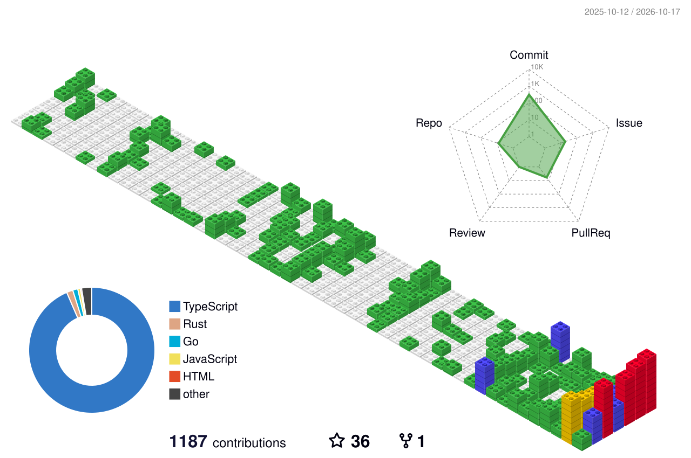

<!-- neofetch 卡片由 scripts/update-profile.mjs 產生，GitHub Actions 每 6 小時更新 -->
<a href="https://blog.sao-x.com">
  <picture>
    <source media="(prefers-color-scheme: dark)" srcset="./assets/neofetch-dark.svg" />
    
  </picture>
</a>

 

### Hi 👋 我是唯一

我4台灣人，住台北，在 MSI 寫 code。白天寫 Web，晚上在家裡的 Proxmox 上自架各種東西，踩到的坑都寫在[部落格](https://blog.sao-x.com)。

### 📝 最近寫的文章

<!-- BLOG-POSTS:START -->
- `2026-10-08` [Caddy + Cloudflare 自動更新動態 IPv6 DDNS](https://blog.sao-x.com/posts/caddy-cloudflare-dynamic-ipv6-ddns) #self-hosted
- `2026-08-30` [手機版卡片被撐破：一個 min-width: auto 引起的水平溢出](https://blog.sao-x.com/posts/css-min-width-auto-horizontal-overflow) #programming
- `2026-08-04` [自架 ShareX 神器 Zipline](https://blog.sao-x.com/posts/deploy-zipline-docker-caddy) #self-hosted
- `2026-08-04` [修好 zed-i18n 中文化版在 Windows 11 消失的右鍵選單](https://blog.sao-x.com/posts/fix-zed-i18n-windows-11-context-menu) #others
- `2026-08-03` [Elysia 的 context.server 為什麼是 undefined？一次 requestIP 回傳 null 的除錯紀錄](https://blog.sao-x.com/posts/elysia-sucrose-requestip-null) #programming
- `2026-07-26` [【心得】為了解救女友的手機：PVE 顯卡直通 + 繞過 ACE 反作弊跑《鳴潮》全紀錄](https://blog.sao-x.com/posts/pve-gpu-passthrough-moonlight-mingchao-ace-anticheat-vm) #self-hosted
<!-- BLOG-POSTS:END -->

<!-- THINKING:START -->
> 💭 🎉 自訂右鍵功能正式啟動！🤣 現在只要按下右鍵，就能享受更方便、更直覺的操作體驗！ 快去試試看，有什麼想法或建議也歡迎留言告訴我～ — [2026-07-18](https://blog.sao-x.com/thinking)
<!-- THINKING:END -->

### 🔧 最近在做

- [**TIPX**](https://tipx.sao-x.com) — 德明的 TIP 系統太難用，乾脆自己做一個。課表、成績、作業、請假都在裡面
- [**takming-forum**](https://github.com/sao-coding/takming-forum-web) — 給德明學生評課、賣二手書的地方
- [**AppPulse**](https://github.com/sao-coding/AppPulse) — Go 寫的小工具，抓電腦正在播的音樂跟前景視窗，丟去 Webhook
- [**sao-blog**](https://github.com/sao-coding/sao-blog) — 這個部落格本體，Next.js + Elysia + oRPC，也有 MCP 可以直接叫 AI 發文
- [**3d**](https://github.com/sao-coding/3d) — 幫朋友代印 3D 列印的報價網站

 

<!-- 3D contribution 由 yoshi389111/github-profile-3d-contrib 每天產生 -->
<picture>
  <source media="(prefers-color-scheme: dark)" srcset="./profile-3d-contrib/profile-night-rainbow.svg" />
  
</picture>

<!-- 貪食蛇由 Platane/snk 每天產生 -->
<picture>
  <source media="(prefers-color-scheme: dark)" srcset="https://raw.githubusercontent.com/sao-coding/sao-coding/output/github-snake-dark.svg" />
  
</picture>

