<!-- 兩張卡片都由 scripts/update-profile.mjs 產生，GitHub Actions 每 6 小時更新 -->
<a href="https://blog.sao-x.com">
  <picture>
    <source media="(prefers-color-scheme: dark)" srcset="./assets/neofetch-dark.svg" />
    
  </picture>
</a>

  <a href="https://blog.sao-x.com">blog</a> ·
  <a href="https://www.x.com/sao_coding">x</a> ·
  <a href="https://www.youtube.com/@sao-coding">youtube</a> ·
  <a href="https://www.twitch.tv/aox_s">twitch</a> ·
  <a href="https://discord.com/users/vx._.xv">discord</a> ·
  <a href="https://www.threads.net/@_xox._.xox._.xox._.xox._.xox_">threads</a> ·
  <a href="mailto:only@sao-x.com">mail</a>

Taiwanese dev in Taipei, writing code at MSI. Web stuff by day, self-hosting everything on a Proxmox box at home by night — the rabbit holes end up on my [blog](https://blog.sao-x.com) (in Chinese).

#### Latest posts

<!-- BLOG-POSTS:START -->
- `2026-10-20` [test](https://blog.sao-x.com/posts/test-2) #others
- `2026-10-08` [Caddy + Cloudflare 自動更新動態 IPv6 DDNS](https://blog.sao-x.com/posts/caddy-cloudflare-dynamic-ipv6-ddns) #self-hosted
- `2026-08-30` [手機版卡片被撐破：一個 min-width: auto 引起的水平溢出](https://blog.sao-x.com/posts/css-min-width-auto-horizontal-overflow) #programming
- `2026-08-04` [自架 ShareX 神器 Zipline](https://blog.sao-x.com/posts/deploy-zipline-docker-caddy) #self-hosted
- `2026-08-04` [修好 zed-i18n 中文化版在 Windows 11 消失的右鍵選單](https://blog.sao-x.com/posts/fix-zed-i18n-windows-11-context-menu) #others
- `2026-08-03` [Elysia 的 context.server 為什麼是 undefined？一次 requestIP 回傳 null 的除錯紀錄](https://blog.sao-x.com/posts/elysia-sucrose-requestip-null) #programming
<!-- BLOG-POSTS:END -->

<!-- THINKING:START -->
> 💭 🎉 自訂右鍵功能正式啟動！🤣 現在只要按下右鍵，就能享受更方便、更直覺的操作體驗！ 快去試試看，有什麼想法或建議也歡迎留言告訴我～ — [2026-07-18](https://blog.sao-x.com/thinking)
<!-- THINKING:END -->

#### Working on

- [**Tessera**](https://github.com/Limatura/tessera) — self-hosted file and note sharing that cleans up after itself. One Rust binary, short codes, expiry and download limits, local disk or S3
- [**TIPX**](https://tipx.sao-x.com) — my school's student portal was painful to use, so I rebuilt it: timetable, grades, assignments and leave requests in one place
- [**takming-forum**](https://github.com/sao-coding/takming-forum-web) — course reviews and a used-textbook market for students at my school
- [**AppPulse**](https://github.com/sao-coding/AppPulse) — tiny Go tool that picks up what's playing and the active window on my PC, then forwards it to a webhook
- [**sao-blog**](https://github.com/sao-coding/sao-blog) — the blog itself: Next.js + Elysia + oRPC, with an MCP server so AI can publish posts

<picture>
  <source media="(prefers-color-scheme: dark)" srcset="./assets/contrib-dark.svg" />
  
</picture>
